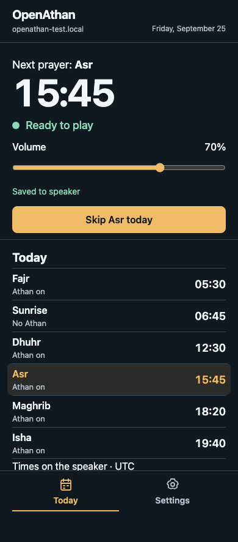

# OpenAthan

Turn a supported speaker into an Athan and Quran speaker for your home. OpenAthan
calculates prayer times and plays the Athan automatically, with settings you can
control from your phone. It is open source and works without Home Assistant,
soldering, or programming.

**Current release: [v0.8.0](docs/releases/v0.8.0.md).**
[Latest release and downloads](https://github.com/OpenAthan-Project/openathan/releases/latest)
· [Choose hardware](#supported-speakers) · [Set up your speaker](#get-started)

## What you can do

- **Hear the Athan automatically** for the prayers you enable, with a separate
  Fajr recording stored on the speaker.
- **Adjust prayer times** for your location, timezone, calculation and Asr
  methods, with individual prayer adjustments and a timetable to review.
- **Control playback from your phone:** change volume, stop audio, or skip and
  restore the next announcement. Saved playback history prevents unwanted repeats
  across restarts.
- **Listen to Quran:** choose a reciter, recording edition and surah from
  MP3Quran. Scheduled Athan takes priority; interrupted Quran does not resume
  automatically.
- **Enable dua after Athan:** an optional recording plays after a completed
  scheduled Athan. It is off by default. Existing speakers download it when
  enabled; once installed, it plays offline.
- **Set up over phone or USB.** On supported screens, a button shows QR codes and
  the speaker's address so you can find its page again.
- **Customize the supported screen and lights**, including screen brightness and
  12/24-hour time. Available controls depend on the hardware.
- **Update over Wi-Fi** from the speaker's settings while keeping saved settings
  and recordings. USB recovery can change Wi-Fi or reset a forgotten speaker
  password without erasing prayer settings or playback history.

*Simulated phone preview with example times and a test hostname. Appearance and
available controls depend on firmware and hardware.*

## Supported speakers

Both options run the same core Athan and Quran features and use the browser
installer. Buy the exact supported model and revision.

| Speaker | Assembly and interface | Setup guide |
| --- | --- | --- |
| **M5Stack AtomS3R C126 + Voice Pyramid A167** | Two modules to connect; small screen, front button and prayer-status lights | [Parts and setup](hardware/reference-builds/voice-pyramid/assembly.md) |
| **Waveshare ESP32-S3-Touch-LCD-1.85C-BOX V2** | Pre-assembled speaker; round screen and BOOT button | [Parts and setup](hardware/reference-builds/waveshare-box-v2/README.md) |

**Check before buying:** Waveshare **V1 is unsupported**. The Atom profile targets
the **GC9107 display**; newer ST7735 revisions are not qualified. A167 is also
sold/documented as **Echo Pyramid**. Touch input, microphones and SD storage are
not supported by OpenAthan, even where the hardware includes them.

See the [hardware comparison and compatibility guide](hardware/README.md) for
accessories, clock behavior and model-specific limits. Audio playback is required;
screens, lights and other peripherals are optional to OpenAthan's reusable core.

## Get started

You need supported hardware, a computer with **desktop Chrome or Edge**, a
**USB data cable**, USB power, and a **2.4 GHz WPA2/WPA3 personal Wi-Fi network**.
A charging-only cable will not work for installation. Networks requiring a web
sign-in or enterprise authentication are unsupported.

1. Follow your speaker's hardware guide above to connect the correct USB port.
2. Open [USB setup](https://openathan.com/install/) on your computer to install
   OpenAthan. **A new installation erases existing firmware and saved data.**
3. Choose phone setup now or later, or continue on the computer. No coding is
   required. Follow the [complete setup guide](https://openathan.com/docs/getting-started/).
4. Open the speaker's local page, choose your location and prayer settings, and
   review the timetable. Select **Finish setup** to enable automatic Athan.

Keep your phone and speaker on the same home Wi-Fi for everyday controls. Phone
enrollment uses a temporary open setup network; perform initial setup in a trusted
place. You can join that network manually without scanning a QR code.

**Already installed?** Open the speaker's settings to check for updates, or use
USB setup for Wi-Fi/password recovery. Do not choose a fresh installation to
update an existing speaker. See the [preserving update guide](docs/development/firmware-upgrades.md)
for older firmware or bootloader compatibility.

## Internet, compatibility and help

- **Stored Athan and installed dua work offline once the clock is valid.**
  First setup needs internet time. Atom needs internet time again after a cold
  boot. Waveshare Box V2 can restore initialized clock time across powered
  restarts; unplugged retention and backup-battery behavior remain unqualified.
- **Quran streaming needs internet access to MP3Quran.** It does not provide an
  offline Quran library, ayah controls or playback bookmarks.
- Settings and scheduling run locally without the public website or Home
  Assistant. Home Assistant integration, touch controls and additional storage
  remain future work in the [roadmap](docs/development/roadmap.md).
- If a `.local` address will not open, use the speaker's displayed current IP
  address. See [troubleshooting](https://openathan.com/docs/troubleshooting/) or
  [report an issue](https://github.com/OpenAthan-Project/openathan/issues/new/choose)
  with your model, firmware version and what happened.

These are pre-1.0 releases. Read the [release notes and validation limits](docs/releases/v0.8.0.md)
before installing. Publication and automated checks do not establish physical
qualification of every release image, hardware revision or network condition.

## For contributors and ESPHome users

Start with [contributing](CONTRIBUTING.md), [build and test instructions](.github/workflows/README.md),
the [architecture guide](docs/development/architecture.md), and the
[device UI guide](web/device-ui/README.md). Report security vulnerabilities through
[private reporting](SECURITY.md).

ESPHome users can compose the [reusable integration](firmware/esphome/README.md)
from a local checkout with compatible audio and optional peripherals. Custom
hardware needs development and validation; it is not automatically supported by
the public installer. Remote package consumption remains unvalidated.

This repository owns firmware, the framework-independent product core, the local
device UI, hardware guides and release artifacts. The separate
[website repository](https://github.com/OpenAthan-Project/website) owns public
setup documentation and the installer; it consumes published artifacts and does
not compile firmware. See [release tooling](docs/development/releases.md) for
maintainer instructions.

## Licensing

- OpenAthan-authored software: [Apache License 2.0](LICENSE), except the
  [vendored ESPHome I2S audio patch](third_party/esphome-i2s-audio/UPSTREAM.md)
  (GPLv3 runtime and MIT Python).
- OpenAthan-authored documentation: [CC BY 4.0](docs/LICENSE.md).
- Future original hardware design sources: [CERN-OHL-P-2.0](hardware/LICENSE.md), unless stated otherwise.
- Third-party dependencies, hardware, and media retain their own terms. See
  [recording attribution and permissions](AUDIO-LICENSES.md).

OpenAthan is an independent community project and is not affiliated with the third-party hardware, software, or content providers referenced in its documentation.
