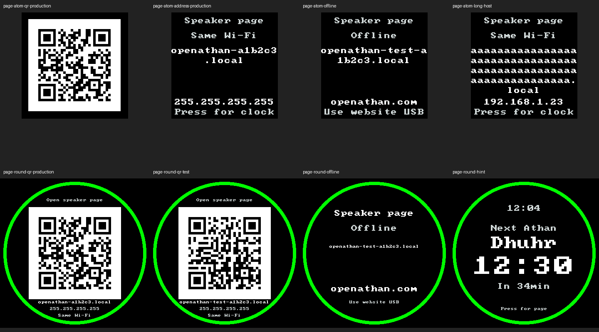

# Speaker-page discovery — development validation, 2026-10-14

This unreleased addition lets an owner find the device-local page without a
bookmark. A short idle press cycles Atom through QR, address information and
normal status. Waveshare shows one combined connection view inside its existing
prayer ring. Both return to normal after 60 seconds without a button action.
Audio Stop, skip/cancel holds, settings and durable prayer records retain their
existing behavior. First-run phone provisioning and public website changes are
separate work.

## Rendering and control evidence

The previews below come from the actual C++ display renderer, using illustrative
hostnames, addresses and prayer values. The image is documentation only; it is
not embedded in firmware. It does not establish physical panel readability or
phone-camera scanning.

- Atom uses a 111×111 QR square including its white quiet zone. Full hostnames
  wrap onto a separate text page; the current IPv4 address is a manual fallback.
- Waveshare uses a 222×222 QR square and native-resolution address text within
  the ring's inner radius. The prayer proximity color continues to update.
- The QR contains the existing HTTP `.local` URL. Offline or unavailable IPv4
  clears it and avoids showing a stale IP; encoding failure uses manual guidance.
- A cached, bounded QR representation is generated with Project Nayuki v1.8.0.
  The [source record](../../firmware/esphome/components/openathan_display/QR-SOURCE.md)
  retains its exact upstream hashes and MIT licensing.
- Physical actions use `openathan.button`; generic Stop/skip/cancel automation
  actions remain unchanged. Every valid short physical action still calls Stop,
  invalidating pending audio requests before any idle navigation.
- Busy detection includes reserved audio sources, stream loading and accepted
  Quran requests still resolving a URL. Catalog browsing does not count as
  playback. Starting pending or active audio closes connection information on
  the display's next refresh.

Renderer tests cover bounds, four-module white borders, longest supported
hostnames, maximum IPv4 text, online/offline/IP changes, missing addresses,
encoding failure and the persistent ring. Independent ZBar 0.23.93 decoding of
four real renderer framebuffers recovered the exact production and isolated-test
HTTP URLs for both layouts. Offline and oversized-QR fallback images contained
no decodable QR.

Production and isolated settings-adapter tests exercise physical routing through
the actual display adapter, monotonic timeout/reset/wrap, immediate Stop epoch
changes, loading/queued/playing cases, generic-action purity, long holds and
absent/failed displays. They verify no additional durable writes. Real Quran
service tests separately cover stale/canceled work and Stop before worker
completion. ESPHome configuration tests cover the optional reader, both layouts,
all physical-action kinds and rejection of invalid/missing action values.

The full automated run passed all **20 UBSan CTests** and **138 Python tests**
with no skipped tests. Project-authored whitespace and changed-document local
links also passed. The two byte-exact upstream QR files retain their original
formatting as documented in the source record.

## Matched firmware capacity

Baseline source is `176ca3ebb55e5f91336bd35d8f815933d0bb0565` (v0.6.0).
Both sides use Python 3.13.5, ESPHome 2026.9.0, ESP-IDF 5.5.5 and Xtensa GCC
14.2.0 (`esp-14.2.0_20260121`), with identical configuration, source/build paths,
embedded baseline commit metadata and generated compile-only audio fixtures.
The candidate overlays the reviewed implementation files. These measurement
images must never be installed or played.

| Profile | Baseline OTA bytes | Candidate OTA bytes | Delta | Budget remaining | Static RAM bytes (delta) |
| --- | ---: | ---: | ---: | ---: | ---: |
| Atom reference | 1,306,128 | 1,318,608 | +12,480 | 254,256 | 116,479 (+496) |
| Isolated provisioning | 1,307,840 | 1,320,000 | +12,160 | 252,864 | 116,479 (+496) |
| Upgrade qualification | 1,312,608 | 1,324,720 | +12,112 | 248,144 | 116,551 (+496) |
| Startup-failure qualification | 1,312,608 | 1,324,720 | +12,112 | 248,144 | 116,551 (+496) |
| Waveshare production | 1,310,048 | 1,322,400 | +12,352 | 250,464 | 116,667 (+488) |
| Waveshare display development | 1,288,272 | 1,300,464 | +12,192 | 272,400 | 116,667 (+488) |
| Waveshare diagnostics | 1,375,120 | 1,387,424 | +12,304 | 185,440 | 117,327 (+488) |
| Quran qualification | 1,377,600 | 1,389,904 | +12,304 | 182,960 | 117,335 (+488) |
| Scheduler without display | 1,124,496 | 1,124,528 | +32 | 448,336 | 113,555 (+16) |
| Scheduler validation without display | 1,142,080 | 1,142,112 | +32 | 430,752 | 114,267 (+16) |
| Waveshare audio without display | 1,238,464 | 1,238,544 | +80 | 334,320 | 113,771 (+16) |

All eleven matched pairs pass the dependency, partition, factory/OTA consistency,
qualification-isolation and audio-capacity checks. Each pair retains an identical
resolved dependency lock. Every application stays below 1,572,864 bytes in its
unchanged 2,097,152-byte slot, preserving both OTA slots and the 3.5 MiB shared
audio partition. The three builds without displays exclude the QR/display
component and retain the original physical-control fallback.

Final configuration checks also generate standalone scheduler/display compositions
for both boards without loading the product setup service. Reader wiring belongs
to the product entrypoints; the optional Device validator is imported only when
used. Moving that wiring leaves official Atom and both Waveshare parent profiles
generated C++ byte-for-byte identical.

## Physical and release limits

No device access, installation, audio playback or physical scanning was performed
for this implementation. Existing dated hardware findings retain their original
scope. Physical acceptance must verify both panels' readability, phone scanning,
`.local` and current-IP access on the same LAN, authentication, controls and
normal audio operation.

The existing framebuffer sizes remain unchanged. QR generation uses fixed
caller buffers, while connection snapshots and callback plumbing use C++ strings
and function objects. Static RAM and build success do not establish runtime heap,
fragmentation, stack or PSRAM headroom during concurrent audio/network/display
activity. Measure these separately in a coordinated hardware session, preserving
settings, prayer history, shared audio and compatible application-only recovery.
Firmware release qualification and publication remain separate from this report.
