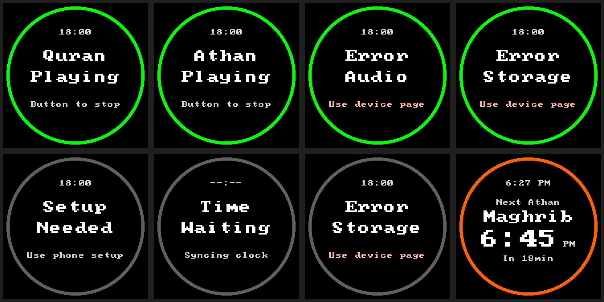

# Waveshare persistent-ring validation — 2026-10-14

The Waveshare prayer ring remains visible during Quran/Athan playback, setup,
clock-waiting and faults. Center messages, stop guidance and the existing
upcoming-prayer countdown layout are preserved. The automated implementation
checkpoint below is followed by the separately attended installation and
Quran/Maghrib observations. Physical setup/fault readability and exact color
boundaries remain untested.

## Behavior and compatibility

The presenter calculates proximity independently of the center-screen state,
using the existing validated, strictly future visual prayer. Exact UTC duration
sets green above 30 minutes, orange above 10 through 30 minutes and red within
10 minutes. Muted and skipped calculated prayers still participate. At a prayer
timestamp, the ring advances to the next future prayer, including during Athan.

The renderer always draws the existing 8px band at radii 164–172px. Incomplete
setup, unhealthy settings storage, an invalid clock or missing/invalid future
prayer timing gives a neutral gray ring (`#606060`). Audio or consumption-history
faults can retain a timing color when the independent visual timetable is valid.
Unavailable timing clears the color rather than retaining a stale frame.

The Atom layout, screen brightness, 259,200-byte Waveshare framebuffer,
one-second polling and visible-frame deduplication are preserved. There are no
new persistent records, HTTP APIs, fonts, embedded images or dependencies.

## Automated validation

- All 20 CMake/CTest checks passed with UndefinedBehaviorSanitizer.
- All 135 Python tests passed with no skips using the pinned ESPHome environment.
- The production and isolated settings/display adapters passed against pinned
  ESPHome timezone conversion and ArduinoJson 7.4.3 headers.
- New presenter coverage fails against unchanged main, reproducing the previous
  loss of prayer proximity during playback.
- Renderer checks verify every pixel of the ring and ensure status text remains
  inside its inner radius. The design detector reported no findings.

Coverage includes Quran/Athan playback, every scheduler fault category, gray
fallback/recovery, exact 30-/10-minute thresholds during playback, muted/skipped
prayers, Offline, unchanged-frame caching, invalid/stale timing, and the normal
Quran-to-Athan scheduled handoff selecting the following prayer. Adapter polls
preserve settings and perform no additional durable writes.

These host previews use the shipping C++ renderer and existing bitmap font with
illustrative values. Top row: Quran, Athan, audio fault and history-storage fault
with valid prayer timing. Bottom row: setup, clock-waiting, settings-storage
fault and the existing upcoming-prayer layout. The image is documentation only
and is not embedded in firmware.

## Matched firmware capacity

Baseline source: `6a197fa0e29ced28045aaeb31fb9014804c4d733`.
Both phases use Python 3.13.5, ESPHome 2026.9.0, ESP-IDF 5.5.5 and Xtensa GCC
14.2.0 (`esp-14.2.0_20260121`), identical profile configuration, source/build
paths, embedded baseline commit metadata and generated compile-only fixtures.
Only the two display headers change between phases. Synthetic audio fixtures
must never be installed or played.

| Profile | Baseline OTA bytes | Candidate OTA bytes | Delta | Budget remaining | Slot free |
| --- | ---: | ---: | ---: | ---: | ---: |
| Atom reference | 1,306,080 | 1,306,128 | +48 | 266,736 | 791,024 |
| Isolated provisioning | 1,307,792 | 1,307,840 | +48 | 265,024 | 789,312 |
| Upgrade qualification | 1,312,560 | 1,312,608 | +48 | 260,256 | 784,544 |
| Startup-failure qualification | 1,312,560 | 1,312,608 | +48 | 260,256 | 784,544 |
| Waveshare production | 1,309,984 | 1,310,048 | +64 | 262,816 | 787,104 |
| Waveshare display development | 1,288,208 | 1,288,272 | +64 | 284,592 | 808,880 |
| Waveshare diagnostics | 1,375,056 | 1,375,120 | +64 | 197,744 | 722,032 |
| Quran qualification | 1,377,536 | 1,377,600 | +64 | 195,264 | 719,552 |

All 16 builds passed the existing dependency, partition, factory/OTA consistency,
qualification-exclusion and audio-capacity checks. Each pair has an identical
resolved dependency lock. Static RAM delta is zero for every profile. All actual
OTA images remain below the 1,572,864-byte application budget in unchanged
2,097,152-byte slots; both slots and the 3.5 MiB shared audio partition are retained.

## Original implementation checkpoint and limits

No device access, installation, playback, release or website change was performed
for the automated implementation checkpoint. Existing dated hardware findings
retain their original scope.
The same framebuffer and frame representation are used, with no new dynamic
allocation; static RAM and successful compilation do not establish concurrent
audio/network/display runtime headroom or physical readability. A future
coordinated hardware session must reidentify live state and preserve settings,
prayer history, shared audio and compatible application-only recovery.

## Attended installation and playback — 2026-10-14

Merged source `b1d64e3ff1a66a373aaa6abcff4befb2ed9e8009`
([PR #49](https://github.com/OpenAthan-Project/openathan/pull/49)) passed all
13 exact-main [CI checks](https://github.com/OpenAthan-Project/openathan/actions/runs/38637497426)
before installation on one Waveshare Box V2. The clean production-profile
development application retains version v0.5.0 with the new source identity;
it is not a newly published release. Synthetic fixtures were not installed or played.

| Application | OTA bytes | SHA-256 | Application budget remaining |
| --- | ---: | --- | ---: |
| Previous production, `9e47867` | 1,284,784 | `f986f5aa6440ade6985d8df0fca1a2ef524e781ce1fa1703e602bc1e30e568d4` | 288,080 |
| Installed development, `b1d64e3` | 1,310,048 | `b0d896956475642a94bbdc4f262ebe660a642ba8105d4a3f08376cf7045af255` | 262,816 |

The installed application's +25,264-byte difference includes the intervening
Quran/audio changes. It is distinct from the +64-byte ring-only matched comparison
above. The installed image leaves 787,104 bytes free in its unchanged 2 MiB slot
and uses 116,179 static RAM bytes. It was built with the same pinned Python 3.13.5,
ESPHome 2026.9.0, ESP-IDF 5.5.5 and GCC 14.2.0 environment.

Fresh paired full 16 MiB reads matched before installation. One pre-write serial
read stopped without any flash mutation; a complete segmented read then matched
the baseline. Its transport cause remains unresolved. One application-only write
and independent complete readback verified every byte outside the actual new
application unchanged, including its final-sector padding, NVS/settings/history,
credentials, shared audio, bootloader, partition table, OTA metadata and inactive
slot. Fresh compatible application-only recovery was retained. Historical
full-flash restoration was not used.

| Check | Software result | Owner observation |
| --- | --- | --- |
| First Quran sample | Playing, one Stop, healthy idle and preserved settings/history. | Owner was absent; physical result unobserved. |
| Attended Quran repeat | One fresh-token Play, bounded 20-second sample, one Stop and healthy idle/ready. | Ring visible during playback and after Stop; clear audio and clean Stop confirmed. |
| Real Maghrib at 18:36 Toronto | Pre-event idle, natural Athan ownership, next prayer Isha, normal consumption advance and healthy idle/ready afterward; 157 successful status reads, zero read errors/faults. | Ring visible throughout Athan and afterward; full recording clear and completed. |

The first Maghrib playing sample arrived 0.87 seconds after its due time. The
233.12-second sampled playing span is an observation interval, not an exact
recording-duration measurement. Collection finished at 22:39:59 UTC.
Only Maghrib's normal consumption watermark advanced; the other four watermarks,
settings revision 6, volume 50%, brightness 50%, time format and light preferences
were unchanged. No unexpected restart was observed. The Maghrib collector issued
only authenticated status reads, with no Play, Stop, skip, clock/settings/history
change or substituted occurrence. Its one-occurrence follow-up was paused.

These owner confirmations establish playback-screen visibility and listening for
this unit. They do not establish exact physical color transitions, setup/fault
gray, a new cold-power repeat, extended soak or clean-production runtime heap,
fragmentation, PSRAM or stack headroom. Host coverage and previews retain their
separate scope. Earlier failures and missing listening observations remain dated
evidence; this session is not blanket release qualification. Private backup,
readback, source/build and listener evidence stays outside Git.
